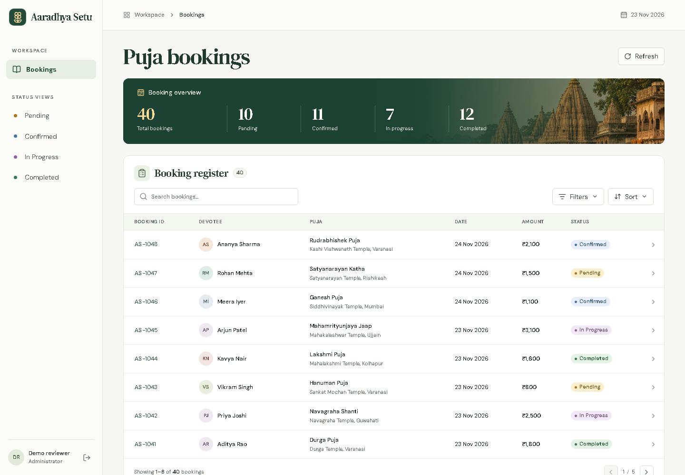

# Aaradhya Setu · Puja bookings

A responsive booking dashboard built for Option 2 of the Software Engineering Intern assignment.

**[Open the interactive dashboard](https://aaradhya-setu-bookings.vercel.app/?demo=1)**

Every reviewer gets 40 fictional bookings in a private, eight-hour workspace. Open a booking, change its status and refresh to see the saved change. Search by booking ID, devotee or puja, combine status and puja filters, or sort by date, amount, devotee and booking ID.



## Run locally

Use Node.js 24, npm and a running MongoDB server on port 27017.

```sh
npm ci
npm run demo
```

Open http://127.0.0.1:3000. This loopback-only demo uses the dedicated database `aaradhya_setu_local_demo`. Running it again preserves changes. Use `npm run dev` for hot reloading.

## How the application works

React renders the table, status overview and details drawer. Express validates filters and applies sorting and pagination in MongoDB. An ID tie-breaker keeps equally priced or dated bookings in a consistent order. Currency values are stored as whole rupees and ceremony dates as calendar dates.

The details drawer sends the version it originally read with each status update. MongoDB matches that version in the atomic write. A competing edit receives HTTP 409 and the drawer loads the latest booking before the user retries.

| Endpoint | Purpose |
| --- | --- |
| GET /api/health | Check application and database availability |
| GET, POST, DELETE /api/session | Inspect session, sign in or enter the reviewer demo, sign out |
| GET /api/bookings | Read a filtered page, status totals and available pujas |
| GET /api/bookings/:id | Read booking, ceremony and devotee details |
| PATCH /api/bookings/:id | Save a status with its current version |

Admin sessions use opaque tokens in HttpOnly cookies. The database stores a keyed digest of each token. Sessions expire after eight hours. Reviewer records are copied from fictional fixtures into a separate collection and scoped to their session on every read and write. TTL indexes clean up expired data. Sign-in throttling uses MongoDB so function instances share the same counters.

## Test

```sh
npx playwright install chromium
npm test
```

The suite builds the client, starts real HTTP servers on ephemeral ports, and creates and removes isolated MongoDB test databases. It covers desktop and mobile flows, competing edits, isolated reviewer sessions, sign-out, recovery from failures, and persistence after restarting the Node process. Set `TEST_MONGODB_URI` to use a dedicated test MongoDB instance.

## Deploy

The live app runs on Vercel with MongoDB Atlas. Vite serves versioned static assets and the Node function in `api/index.js` reuses its database connection across warm requests. For a standalone deployment, run `npm run build` and `npm start` behind HTTPS.

Configure `MONGODB_URI`, `MONGODB_DB`, `ADMIN_PASSWORD` (at least 12 characters) and `SESSION_SECRET` (at least 32 characters) in the host's secret settings. `ADMIN_NAME` controls the account label. Enable `REVIEW_DEMO=true` for isolated reviewer workspaces. Set `SEED_DEMO=true` only when the admin workspace should also contain fictional records. Secure cookies are the default. The example environment uses HTTP cookies for local loopback testing. On a standalone server set `HOST`, `PORT` and optionally `PUBLIC_ORIGIN` to match the HTTPS reverse proxy.

The admin account is shared by design for this single-operator assignment. Before handling actual devotee data, configure operator-specific access, audit retention, monitoring and a tested database recovery policy.

The temple photograph is an AI-generated illustration created with built-in ImageGen. [View the image](public/temple.webp).
